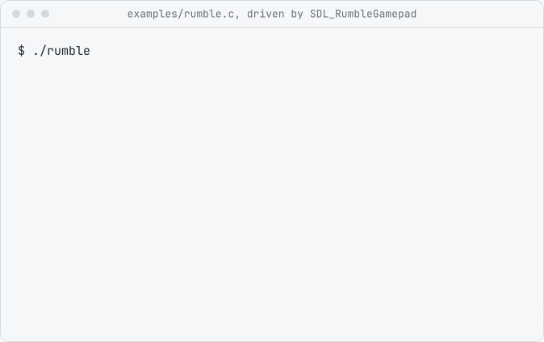

# vpad

Creates a virtual gamepad, sends its input and hands you the rumble the game asks for, with the
same C API on Linux, FreeBSD, macOS and Windows.

<picture>
  <source media="(prefers-color-scheme: dark)" srcset="docs/images/rumble-dark.gif">
  
</picture>

*[`examples/rumble.c`](examples/rumble.c) on Linux while an SDL3 program calls
`SDL_RumbleGamepad`.*

| System | Backend | Needs |
| --- | --- | --- |
| Linux | uinput | write access to `/dev/uinput` (udev rule, ACL or the `input` group) |
| FreeBSD | uinput | the `uinput` module and access to `/dev/uinput` |
| macOS 12+ | IOHIDUserDevice | the `com.apple.developer.hid.virtual.device` entitlement |
| Windows 7+ | ViGEmBus | the ViGEmBus driver; ViGEmClient is not needed |

Anywhere else it builds, and `vpad_create` returns `VPAD_ERR_UNSUPPORTED`.

## Background

Each system fakes a gamepad its own way, has its own library for it (libevdev, ViGEmClient),
and gives the game's rumble back in its own shape, if at all. A remapper or a controller
forwarder that runs on more than one system ends up written three times. vpad is those three
behind one API, with force feedback arriving as the same events everywhere. Its effects have the
layout of [padff](https://github.com/augustoflorentino/padff)'s `pff_effect_t`, so they can go
straight into that mixer.

## Features

- Xbox 360 (045e:028e) on every backend, DualShock 4 (054c:09cc) on Linux and FreeBSD, a
  generic pad, or your own name and USB ids
- one layout: 15 buttons with the d-pad, sticks from -32768 to 32767 (Y positive is down),
  triggers from 0 to 255; the d-pad becomes a hat where the platform expects one
- `vpad_send` sends one report with every change since the last one, and nothing if nothing
  changed
- force feedback as events (effect upload, erase, play and stop, gain, player slot), already
  answered to the game
- input on one thread and force feedback on another, a pollable handle, and `vpad_wake` to free
  a blocked wait
- a missing service is an error, never ignored; `vpad_backend` names the backend in use
- optional custom allocator; also ships as a single header

## Install

```sh
cmake -S . -B build -DBUILD_SHARED_LIBS=ON
cmake --build build
cmake --install build --prefix /usr/local
```

`find_package(vpad REQUIRED)` and `vpad::vpad` from CMake, `pkg-config --cflags --libs vpad`
otherwise.

`scripts/amalgamate.sh` writes `dist/vpad/vpad.h` for projects that would rather copy one file.
Define `VPAD_IMPLEMENTATION` in one `.c` file before any other include, and `VPAD_STATIC` too if
the functions should stay private to it. Link `setupapi` on Windows, `IOKit` and
`CoreFoundation` on macOS.

## Example

```c
vpad_config_t config;
vpad_t *pad = NULL;
vpad_event_t event;
int status;

vpad_config_init(&config, VPAD_XBOX360);
status = vpad_create(&config, &pad);
if (status != VPAD_OK) {
    fprintf(stderr, "%s: %s\n", vpad_backend(), vpad_strerror(status));
    return 1;
}

vpad_set_button(pad, VPAD_BTN_A, 1);
vpad_set_axis(pad, VPAD_AXIS_LX, -32768);
vpad_set_axis(pad, VPAD_AXIS_RT, 255);
vpad_send(pad);

while (vpad_next_event(pad, &event, sizeof(event)) == VPAD_OK) {
    if (event.kind == VPAD_EV_UPLOAD) {
        pff_effect_t effect;

        memset(&effect, 0, sizeof(effect));
        memcpy(&effect, &event.effect, event.effect.size);
        pff_mixer_upload(mixer, event.slot, &effect, now_ms);
    }
}

vpad_neutral(pad);
vpad_destroy(pad);
```

[`examples/basic.c`](examples/basic.c) walks the buttons, a stick and a trigger through 100
reports:

```console
$ ./basic
sent 100 reports through uinput
```

## API

All of it is in [`include/vpad/vpad.h`](include/vpad/vpad.h).

`vpad_config_init` fills `size` and the kind and zeroes everything else. The fields to set:

- `name`: device name, up to 79 bytes; `NULL` keeps the default of the kind
- `vendor`, `product`: USB ids; both 0 keep the default of the kind
- `flags`: `VPAD_NO_FF` makes a pad without force feedback, so a game gets an error at once
  instead of waiting, on Linux, for a `vpad_next_event` an input-only program never calls
- `alloc_fn`, `free_fn`, `alloc_ctx`: your allocator, or `NULL` for `malloc` and `free`

`VPAD_XBOX360` works on every backend and `VPAD_GENERIC` is the same controls under a neutral
identity. `VPAD_DS4`, on Linux and FreeBSD, looks the way the kernel's driver shows a real one:
face buttons by position (`VPAD_BTN_A` is cross), digital L2 and R2 pressed while the trigger
is above 0, rumble only.

| event `kind` | `slot` | `value` | `effect` |
| --- | --- | --- | --- |
| `VPAD_EV_UPLOAD` | effect slot (0 to 15) | | the new or updated effect |
| `VPAD_EV_ERASE` | effect slot | | |
| `VPAD_EV_PLAY` | effect slot | repeat count, 0 stops | |
| `VPAD_EV_GAIN` | 0 | gain, 0 to 65535 | |
| `VPAD_EV_PLAYER` | 0 | player slot the host gave the pad, 0 to 3 (Windows) | |

Minor versions may add kinds; skip the ones you do not know. Effect values follow padff:
magnitudes 0 to 65535, signed levels -32768 to 32767, envelope levels 0 to 65535 (the Linux 0
to 32767 scaled so full maps to full), times in milliseconds.

- `vpad_next_event` takes `sizeof(event)` and fills that much, so a program built against an
  older 3.x keeps working when fields are added; `event.effect.size` says how much of the effect
  arrived. `VPAD_ERR_AGAIN` means nothing is waiting.
- On Linux a game's upload or erase blocks until `vpad_next_event` is called, so keep calling
  it for as long as the pad exists.
- `vpad_wait(pad, timeout_ms)` blocks until an event may be ready (`VPAD_OK`) or the time is up
  (`VPAD_ERR_AGAIN`); -1 waits forever. To wait on other sources as well, poll `vpad_handle`: a
  file descriptor on POSIX, an event for `WaitForSingleObject` on Windows.
- One thread may send input (`vpad_set_button`, `vpad_set_axis`, `vpad_send`, `vpad_neutral`)
  while another reads force feedback (`vpad_next_event`, `vpad_wait`). `vpad_wake`, from any
  thread, makes the current or next `vpad_wait` return at once; call it before `vpad_destroy`.
- `vpad_syspath` gives the pad's sysfs directory on Linux, such as
  `/sys/devices/virtual/input/input42`, so a remapper can skip its own pad. With `buf` `NULL`
  and `buf_len` 0 it reports the length; `VPAD_ERR_RANGE` means the buffer is too small.
- Failing calls return an error code that `vpad_strerror` names. A pad from `vpad_create` is
  released only by `vpad_destroy`, which accepts `NULL` and removes the device.

## Platform limits

- **Windows and macOS**: the game sends only two motor speeds. Each change arrives as an upload
  of an endless rumble effect to slot 0, plus one play the first time; zero speeds mean
  silence. There are no erase or gain events.
- **Windows**: ViGEmBus shows an Xbox 360 pad; the name is ignored, vendor and product are used.
- **macOS**: the pad has its own HID descriptor (hat d-pad, output report 2 for the two
  motors), buttons 1 to 11 in the order of the `VPAD_BTN_` constants.
- **Linux**: other programs that open the pad may send force feedback too (Wine sets the gain
  when it finds a new pad); their requests arrive as events like a game's.
- **Linux and FreeBSD**: 16 effect slots; condition effects (spring, damper and the like) are
  refused to the game with `EINVAL`.

## Development

```sh
cmake --preset dev && cmake --build build/dev && ctest --preset dev
cmake --preset fuzz && cmake --build build/fuzz
```

Tests that create a pad are skipped without access to `/dev/uinput`. The other platforms are
covered in CI: macOS builds and installs, Windows builds with MSVC at `/W4 /WX`, and every push
checks the exported symbols and the ABI and runs `fuzz_events`.

Version 3.3 is complete, and later releases are fixes; see the [CHANGELOG](CHANGELOG.md).
Report bugs in the [issues](https://github.com/augustoflorentino/vpad/issues) with the backend
you used, and vulnerabilities as described in [SECURITY.md](SECURITY.md). Released under the
[MIT license](LICENSE).
